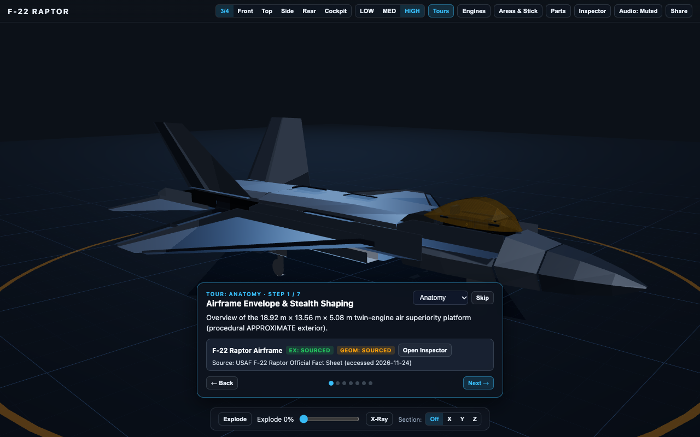
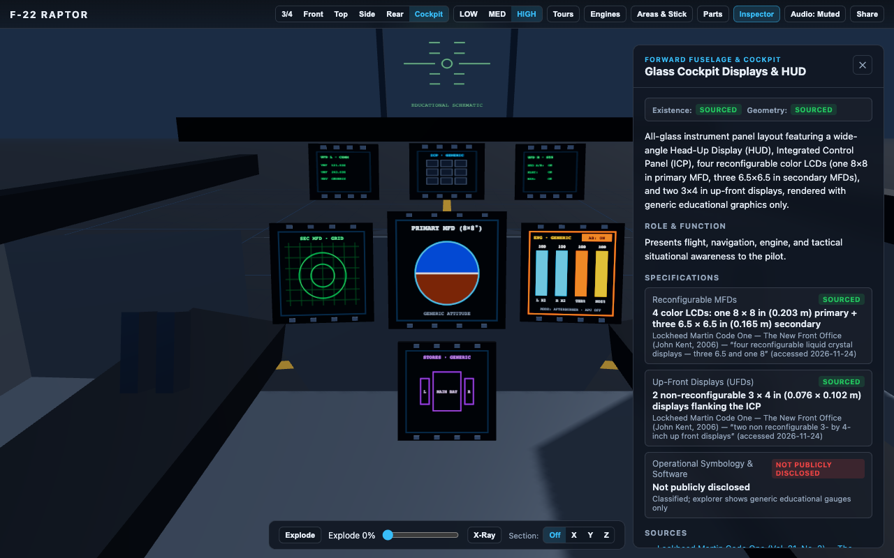
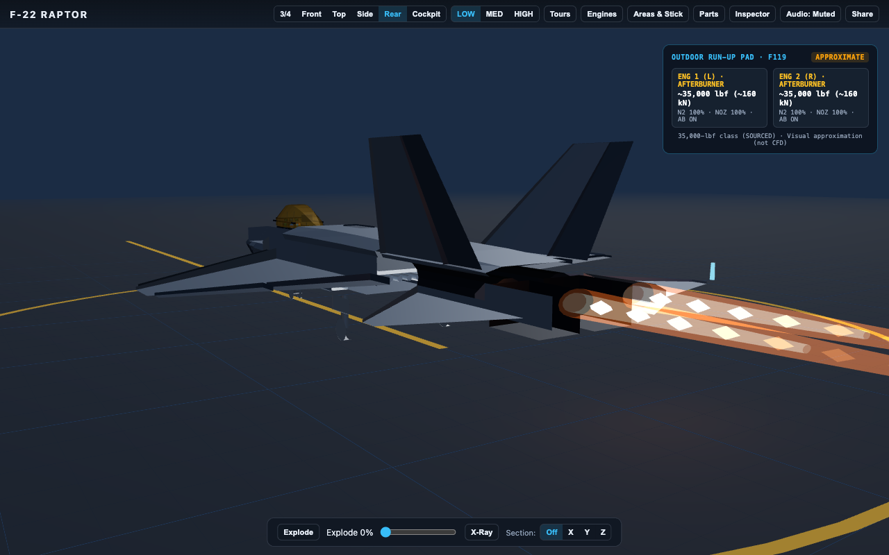
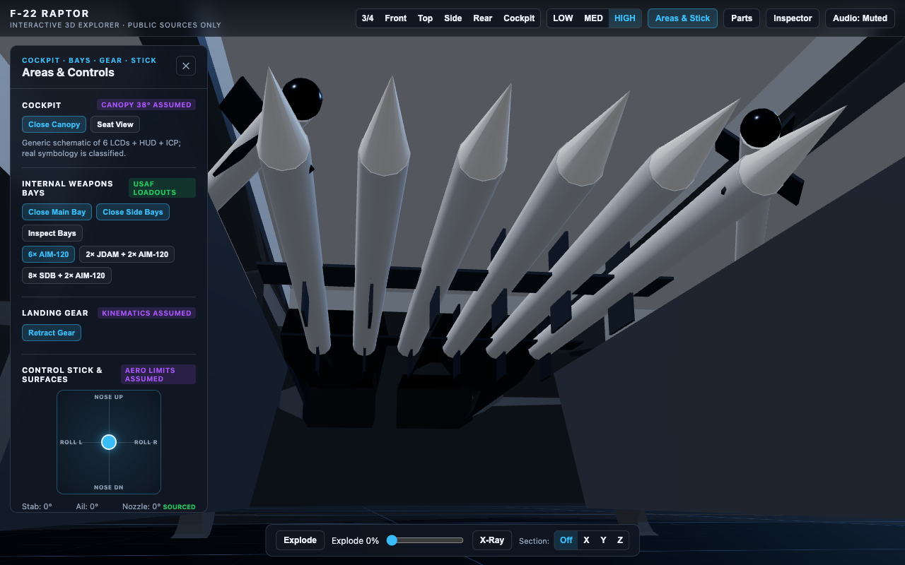
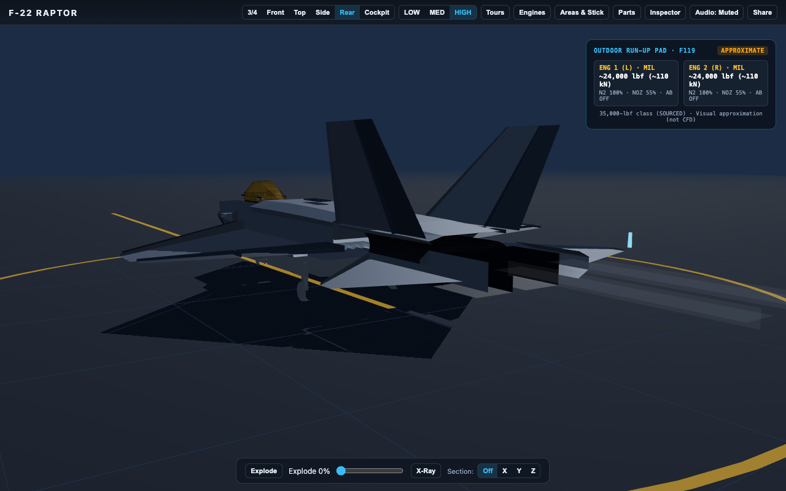
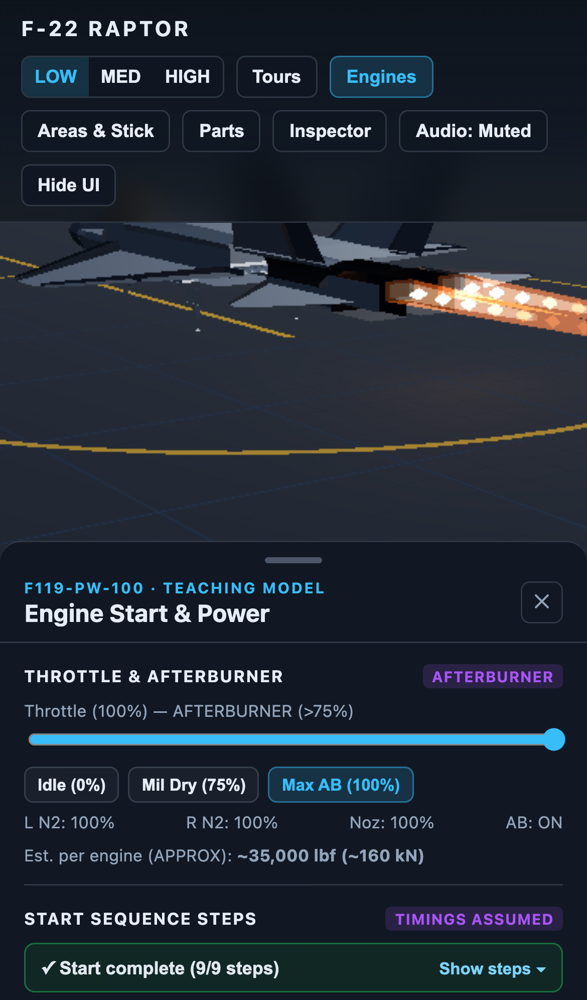

# F-22 Raptor Interactive 3D Explorer

An educational, browser-based 3D explorer of the **Lockheed Martin F-22 Raptor**, built strictly from publicly available sources with transparent provenance labeling, procedural part-based geometry, interactive disassembly, cockpit & weapons-bay inspection, a twin F119-PW-100 start-up/spool teaching simulation, guided tours, and shareable deep links.

**Live demo:** <https://xeroxzen.github.io/f22-explorer/>

## Screenshots

| Guided Tour (Anatomy) | Cockpit 6-LCD Layout (Code One Sourced) | Afterburner & Mach Shock Diamonds |
| :---: | :---: | :---: |
|  |  |  |

| Weapons Bays (AIM-120 / JDAM / SDB) | Mil Power Heat Shimmer | Mobile Engine Sheet (Running) |
| :---: | :---: | :---: |
|  |  |  |

## Provenance Label System

Much of the F-22 Raptor is classified. Rather than fabricating figures or hiding approximations, every specification, constant, and part displays an explicit provenance label:

- **`SOURCED`** — Directly traceable to a cited public source (USAF/NAVAIR fact sheets, Pratt & Whitney, Lockheed Martin *Code One* magazine, or public technical references) with URL/locator and access date. Any quoted snippet in content JSON must be marked `verbatim: true` and verified by hand.
- **`APPROXIMATE`** — Derived from public proportions, thrust classes, or secondary references; displayed with at most 2 significant figures (e.g., `~23,000 lbf (~100 kN)`).
- **`ASSUMED`** — Educational teaching parameter (e.g., engine start-sequence step timings, first-order spool lag constants, aerodynamic surface animation limits) explicitly documented in [`docs/ASSUMPTIONS.md`](docs/ASSUMPTIONS.md).
- **`NOT_PUBLICLY_DISCLOSED`** — Classified or unpublished areas (radar cross-section, operational tactical symbology, detailed F119 fuel/temperature schedules, seeker performance). Never fabricated.

### Live Provenance Counts (Auto-Generated)

<!-- BEGIN GENERATED: LABEL_COUNTS -->
<!-- Auto-generated from src/sim/config/registry.ts and src/content/parts/*.json via `pnpm docs:readme`. Do not edit by hand. -->

| Dataset | Total | `SOURCED` | `APPROXIMATE` | `ASSUMED` | `NOT_PUBLICLY_DISCLOSED` |
| :--- | :---: | :---: | :---: | :---: | :---: |
| Simulation & Model Registry (`src/sim/config/registry.ts`) | **62** | 24 | 10 | 28 | 0 |
| Parts — Existence Provenance (`src/content/parts/*.json`) | **71** | 71 | 0 | 0 | 0 |
| Parts — Geometry Provenance (`src/content/parts/*.json`) | **71** | 1 | 41 | 29 | 0 |
| Component Inspector Specs | **153** | 91 | 10 | 17 | 35 |

<!-- END GENERATED: LABEL_COUNTS -->

## Features

- **44-part procedural disassembly:** Directional, system-tinted exploded view (`0–100%`), X-ray outer-skin ghosting, X/Y/Z section clipping planes, part tree, and dual-badge Inspector (`Existence` + `Geometry`). Automated 3D Separating Axis Theorem (SAT) tests verify zero unintended collisions at `0%` through `100%` explode.
- **Cockpit & Internal Weapons Bays:** Seat-level cockpit view framing all 6 color LCDs sized from Lockheed Martin *Code One* (`1 × 8×8 in` primary MFD, `3 × 6.5×6.5 in` secondary MFDs, `2 × 3×4 in` UFDs) + ICP + HUD + HOTAS + ACES II with generic educational schematics only. Animated main & side weapons bays with USAF/NAVAIR-scaled `AIM-120`, `AIM-9X`, `GBU-32 JDAM`, and `2 × BRU-61/A` racks (`4 × GBU-39B SDB` each).
- **Twin F119-PW-100 Start Sequence & Spool Model:** Pure-TypeScript state machine (`Battery → APU → AMAD Motoring → Ignition → Light-Off → Idle`, Engine 1 then Engine 2, with Abort/Shutdown), first-order spool lag, live cockpit Engine MFD + outside HUD, outdoor run-up pad relocation (no afterburner indoors), rectangular-exit translucent AB plumes with discrete fading Mach shock diamonds (visual approximation, not CFD), and procedural Web Audio (muted by default).
- **Guided Tours & Shareable Deep Links:** 3 skippable, resumable tours (*Anatomy*, *Cockpit*, *Engine Start*) pulling citations directly from the Inspector content registry, plus URL query deep links (`?cam=cockpit&part=...&engine=ab`) that restore steady-state views cleanly.
- **Accessibility & Performance:** Full keyboard navigation (`Tab`, `Escape`, `ArrowLeft`/`ArrowRight` in tours), visible `:focus-visible` rings, `prefers-reduced-motion` support, adaptive quality tier down-stepping on sustained frame drops, and mobile bottom-sheet layouts.

## Running Locally

```bash
pnpm install
pnpm dev              # Start Vite dev server
pnpm typecheck        # TypeScript strict check
pnpm test             # Vitest unit & invariant suite (AST literal guard, SAT collisions, IoU, schema, engine sim)
HEADLESS=1 pnpm e2e   # Playwright desktop + mobile E2E suite (--reporter=list)
pnpm build            # Production build
pnpm docs:assumptions # Regenerate docs/ASSUMPTIONS.md from src/sim/config/registry.ts
pnpm docs:readme      # Regenerate README.md label counts table
```

## Primary Public Sources

- **USAF F-22 Raptor Official Fact Sheet** — <https://www.af.mil/About-Us/Fact-Sheets/Display/Article/104506/f-22-raptor/>
- **Pratt & Whitney F119-PW-100 Public Overview** — 35,000-lbf thrust class, ±20° 2D pitch thrust vectoring
- **Lockheed Martin *Code One* Magazine (June 15, 2006)** — *"The New Front Office"* by John Kent (`codeonemagazine.com`): F-22 cockpit LCD sizes (`1 × 8×8 in`, `3 × 6.5×6.5 in`, `2 × 3×4 in`)
- **USAF AIM-120 AMRAAM Fact Sheet** — <https://www.af.mil/About-Us/Fact-Sheets/Display/Article/104576/aim-120-amraam/>
- **NAVAIR AIM-9X Sidewinder Product Page** — <https://www.navair.navy.mil/product/AIM-9X-Sidewinder>
- **USAF Joint Direct Attack Munition (GBU-31/32/38) Fact Sheet** — <https://www.af.mil/About-Us/Fact-Sheets/Display/Article/104555/joint-direct-attack-munition-gbu-313238/>
- **USAF GBU-39B Small Diameter Bomb Fact Sheet** — <https://www.af.mil/About-Us/Fact-Sheets/Display/Article/104581/gbu-39b-small-diameter-bomb-weapon-system/>
- **Air & Space Forces Magazine — F-22 Raptor Almanac** — <https://www.airandspaceforces.com/weapons-platforms/f-22/>

## Vendored Foundation

Infrastructure modules (constants registry + AST literal guard, content-JSON schema validator, Web Audio acoustics engine, mobile bottom-sheet UI, and Playwright helpers) were vendored from [`falcon-9-simulator`](https://github.com/xeroxzen/falcon-9-simulator) (`v1.9.2`, commit `9de14bb`). All vendored files and modifications are tracked in [`VENDORED.md`](VENDORED.md).

## 3D Model & Environment Attribution

- **F-22 Exterior Mesh (`public/models/f22-raptor-nlm.glb`):** *"F22 Raptor FREE"* by **NLM** (`@NLM-Group`) — <https://sketchfab.com/3d-models/f22-raptor-free-2a64abf0866a405c865466c7642ca689> — licensed under **CC-BY 4.0** (<https://creativecommons.org/licenses/by/4.0/>, accessed & verified `2026-11-25`) — **modified (split into parts, re-materialed)** via [`scripts/blender/split_f22_mesh.py`](scripts/blender/split_f22_mesh.py). Labeled `APPROXIMATE` (not verified against engineering drawings).
- **Environment Maps (`public/hdri/`):** *Aircraft Workshop 01* & *Kloofendal 48d Partly Cloudy PureSky* from **Poly Haven** — **CC0 1.0** (accessed `2026-11-25`).

## Known Limitations

- **Third-party exterior geometry (`APPROXIMATE`):** The exterior glTF mesh is a modified CC-BY 4.0 artist model normalized to the 18.92 m USAF length, not verified against engineering drawings. Parametric reference planform dimensions remain in `src/scene/f22Geometry.ts` for future aerodynamics (`v1.3`).
- **Approximate engine & plume visuals:** The engine model is an educational first-order teaching simulation, and exhaust plumes/shock diamonds are procedural visual approximations (not CFD).
